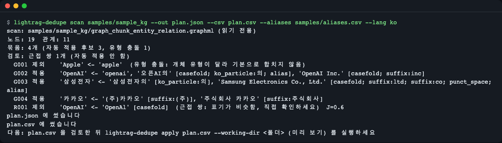
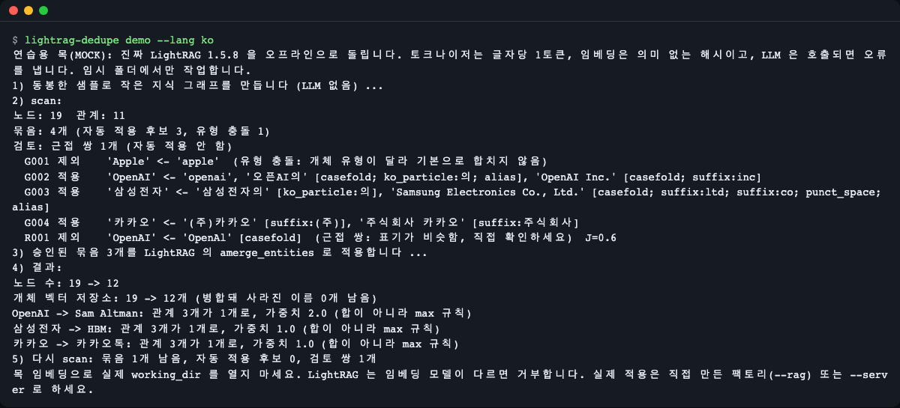
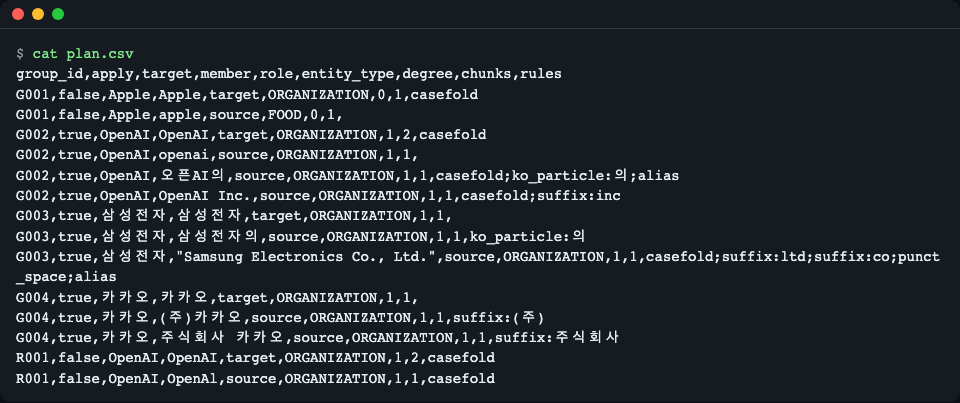
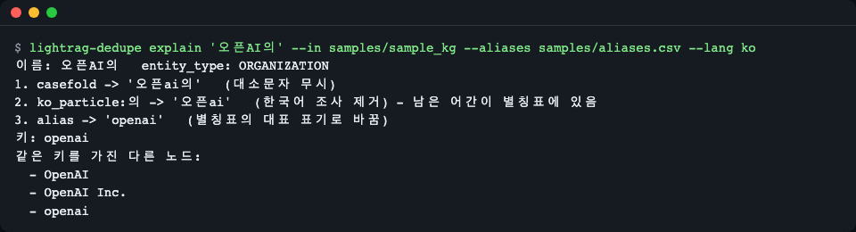
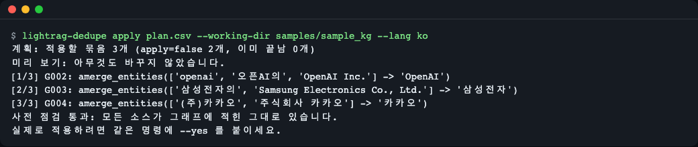
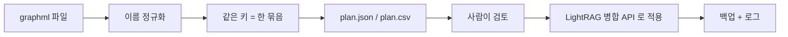

# lightrag-dedupe

[English](README.md) | **한국어**

LightRAG 지식 그래프에서 같은 개체가 다르게 적힌 노드(`OpenAI`, `openai`, `OpenAI Inc.`, `오픈AI의`)를 찾아 검토할 수 있는 병합 계획을 만들고, 승인한 묶음만 LightRAG 공식 병합 API 로 적용합니다. LLM 호출·네트워크·API 키가 없고, 같은 그래프에서는 항상 같은 계획이 나옵니다. LightRAG 에 속하지 않은 비공식 도구입니다.


*`scan` 이 LightRAG 작업 폴더를 읽고, 한 개체일 가능성이 높은 노드 묶음을 맞은 규칙과 함께 보여 줍니다.*

## 이런 분께

- LightRAG 로 문서 수백 개를 넣었는데 그래프 뷰어에서 한 회사가 노드 다섯 개로 보이는 분.
- 한국어와 영어가 섞여 조사(`삼성전자의`), 회사 표기(`(주)카카오`, `Co., Ltd.`), 두 문자 표기(`오픈AI`)가 붙는 분.
- 스크립트로 다시 돌릴 수 있고, 바꾸기 전에 스프레드시트로 검토할 수 있는 정리 단계가 필요한 분.

## 설치

Python 3.11 이상이 필요합니다. [uv](https://docs.astral.sh/uv/) 로 실행하는 것이 가장 쉽습니다 (`curl -LsSf https://astral.sh/uv/install.sh | sh`).

```bash
uv tool install git+https://github.com/LeeGyeongPil/lightrag-dedupe
```

`scan`, `explain`, `restore`, `apply --server` 는 파이썬 표준 라이브러리만 씁니다. `apply --rag` 와 `demo` 는 LightRAG 본체(`lightrag-hku` 1.5.x)가 필요한데, 파이썬으로 LightRAG 를 돌리고 있다면 이미 있습니다.

clone 해서 써 보려면 (데모용 LightRAG 도 함께 설치됩니다):

```bash
git clone https://github.com/LeeGyeongPil/lightrag-dedupe
cd lightrag-dedupe
uv sync
```

최소 리눅스 이미지에서는 위 명령 전에 `git` 과 `curl` 이 필요합니다.

## 빠르게 시작하기 (30초, 연습용 목)

```bash
uv run lightrag-dedupe demo --lang ko
```

```text
연습용 목(MOCK): 진짜 LightRAG 1.5.8 을 오프라인으로 돌립니다. 토크나이저는 글자당 1토큰, 임베딩은 의미 없는 해시이고, LLM 은 호출되면 오류를 냅니다. 임시 폴더에서만 작업합니다.
1) 동봉한 샘플로 작은 지식 그래프를 만듭니다 (LLM 없음) ...
2) scan:
노드: 19  관계: 11
묶음: 4개 (자동 적용 후보 3, 유형 충돌 1)
검토: 근접 쌍 1개 (자동 적용 안 함)
  G001 제외    'Apple' <- 'apple'  (유형 충돌: 개체 유형이 달라 기본으로 합치지 않음)
  G002 적용    'OpenAI' <- 'openai', '오픈AI의' [casefold; ko_particle:의; alias], 'OpenAI Inc.' [casefold; suffix:inc]
  G003 적용    '삼성전자' <- '삼성전자의' [ko_particle:의], 'Samsung Electronics Co., Ltd.' [casefold; suffix:ltd; suffix:co; punct_space; alias]
  G004 적용    '카카오' <- '(주)카카오' [suffix:(주)], '주식회사 카카오' [suffix:주식회사]
  R001 제외    'OpenAI' <- 'OpenAl' [casefold]  (근접 쌍: 표기가 비슷함, 직접 확인하세요)  J=0.6
3) 승인된 묶음 3개를 LightRAG 의 amerge_entities 로 적용합니다 ...
4) 결과:
노드 수: 19 -> 12
개체 벡터 저장소: 19 -> 12개 (병합돼 사라진 이름 0개 남음)
OpenAI -> Sam Altman: 관계 3개가 1개로, 가중치 2.0 (합이 아니라 max 규칙)
삼성전자 -> HBM: 관계 3개가 1개로, 가중치 1.0 (합이 아니라 max 규칙)
카카오 -> 카카오톡: 관계 3개가 1개로, 가중치 1.0 (합이 아니라 max 규칙)
5) 다시 scan: 묶음 1개 남음, 자동 적용 후보 0, 검토 쌍 1개
목 임베딩으로 실제 working_dir 를 열지 마세요. LightRAG 는 임베딩 모델이 다르면 거부합니다. 실제 적용은 직접 만든 팩토리(--rag) 또는 --server 로 하세요.
```


*동봉한 샘플 그래프로 보는 전체 흐름: scan, LightRAG 로 병합, 결과 확인, 다시 scan.*

이것은 **연습용 목(mock) 모드**입니다(출력에도 그렇게 표시됩니다). 임시 폴더에 작은 그래프를 만들고, 임베딩은 의미 없는 해시, LLM 은 호출되지 않습니다. 병합 자체는 진짜 LightRAG 1.5.8 코드가 합니다. 흐름을 보는 용도로만 쓰고, 내 작업 폴더를 목 임베딩으로 열지 마세요(LightRAG 는 임베딩 모델이 다르면 거부합니다).

## 사용법

기본 흐름은 `scan`, `plan.csv` 검토, `apply`(미리 보기), `apply --yes` 입니다.

| 명령 | 하는 일 |
|---|---|
| `scan PATH [--out plan.json] [--csv plan.csv] [--aliases aliases.csv] [--near 0.6]` | 작업 폴더의 그래프 파일을 읽기만 하고 계획을 씁니다. |
| `explain NAME --in PATH [--aliases aliases.csv]` | 노드가 그 키를 얻은 규칙 순서와, 같은 키의 다른 노드를 보여 줍니다. |
| `apply PLAN [--working-dir DIR] [--rag FILE.py:FUNC \| --server URL] [--yes]` | `apply=true` 인 묶음을 적용합니다. `--yes` 가 없으면 부를 호출만 출력합니다. |
| `restore BACKUP --working-dir DIR [--yes]` | `apply` 가 만든 백업으로 되돌립니다. |
| `demo` | 위의 연습용 목. |
| `--lang en\|ko` | 화면 언어(설정 참고). |

종료 코드: `0` 성공, `2` 입력·사용 오류, `3` 계획이 그래프와 어긋남, `4` 병합 실패.

### 1. scan

```bash
uv run lightrag-dedupe scan samples/sample_kg --out plan.json --csv plan.csv --aliases samples/aliases.csv --lang ko
```

```text
scan: samples/sample_kg/graph_chunk_entity_relation.graphml (읽기 전용)
노드: 19  관계: 11
묶음: 4개 (자동 적용 후보 3, 유형 충돌 1)
검토: 근접 쌍 1개 (자동 적용 안 함)
  G001 제외    'Apple' <- 'apple'  (유형 충돌: 개체 유형이 달라 기본으로 합치지 않음)
  G002 적용    'OpenAI' <- 'openai', '오픈AI의' [casefold; ko_particle:의; alias], 'OpenAI Inc.' [casefold; suffix:inc]
  G003 적용    '삼성전자' <- '삼성전자의' [ko_particle:의], 'Samsung Electronics Co., Ltd.' [casefold; suffix:ltd; suffix:co; punct_space; alias]
  G004 적용    '카카오' <- '(주)카카오' [suffix:(주)], '주식회사 카카오' [suffix:주식회사]
  R001 제외    'OpenAI' <- 'OpenAl' [casefold]  (근접 쌍: 표기가 비슷함, 직접 확인하세요)  J=0.6
plan.json 에 썼습니다
plan.csv 에 썼습니다
다음: plan.csv 을 검토한 뒤 lightrag-dedupe apply plan.csv --working-dir <폴더> (미리 보기) 를 실행하세요
```

읽는 법: `G…` 줄은 이름을 정규화하면 같은 키가 되는 노드 묶음입니다. `'OpenAI' <- 'openai', …` 는 "소스들을 타깃으로 합친다"는 뜻입니다. `[...]` 안은 근거, 곧 그 이름을 바꾼 규칙입니다. `제외` 묶음은 기본으로 적용하지 않습니다(계획에서 `apply=false`). `R001` 줄은 *근접 쌍*(`OpenAI` 와 소문자 L 을 쓴 `OpenAl`)입니다. 직접 확인하라고 보여 줄 뿐, 도구가 스스로 합치지는 않습니다.

내 데이터는 `graph_chunk_entity_relation.graphml` 이 들어 있는 LightRAG 작업 폴더를 `scan` 에 넘기면 됩니다.

### 2. 계획 검토

```bash
cat plan.csv
```

```text
group_id,apply,target,member,role,entity_type,degree,chunks,rules
G001,false,Apple,Apple,target,ORGANIZATION,0,1,casefold
G001,false,Apple,apple,source,FOOD,0,1,
G002,true,OpenAI,OpenAI,target,ORGANIZATION,1,2,casefold
G002,true,OpenAI,openai,source,ORGANIZATION,1,1,
G002,true,OpenAI,오픈AI의,source,ORGANIZATION,1,1,casefold;ko_particle:의;alias
G002,true,OpenAI,OpenAI Inc.,source,ORGANIZATION,1,1,casefold;suffix:inc
G003,true,삼성전자,삼성전자,target,ORGANIZATION,1,1,
G003,true,삼성전자,삼성전자의,source,ORGANIZATION,1,1,ko_particle:의
G003,true,삼성전자,"Samsung Electronics Co., Ltd.",source,ORGANIZATION,1,1,casefold;suffix:ltd;suffix:co;punct_space;alias
G004,true,카카오,카카오,target,ORGANIZATION,1,1,
G004,true,카카오,(주)카카오,source,ORGANIZATION,1,1,suffix:(주)
G004,true,카카오,주식회사 카카오,source,ORGANIZATION,1,1,suffix:주식회사
R001,false,OpenAI,OpenAI,target,ORGANIZATION,1,2,casefold
R001,false,OpenAI,OpenAl,source,ORGANIZATION,1,1,casefold
```


*노드마다 한 행입니다. 적용하기 전에 스프레드시트로 열어 `apply` 를 `true`/`false` 로 바꾸거나 `target` 을 고치세요. CSV 열 이름은 언제나 영어입니다.*

`group_id` 가 같은 행이 한 번의 병합입니다. CSV(또는 `plan.json`)를 마음대로 고쳐도 됩니다. `apply` 가 결과를 다시 검사해 빈 소스, 소스에도 들어 있는 타깃, 겹치는 묶음을 거부합니다(종료 코드 2).

### 3. 이름 하나 설명

```bash
uv run lightrag-dedupe explain "오픈AI의" --in samples/sample_kg --aliases samples/aliases.csv --lang ko
```

```text
이름: 오픈AI의   entity_type: ORGANIZATION
1. casefold -> '오픈ai의'   (대소문자 무시)
2. ko_particle:의 -> '오픈ai'   (한국어 조사 제거) - 남은 어간이 별칭표에 있음
3. alias -> 'openai'   (별칭표의 대표 표기로 바꿈)
키: openai
같은 키를 가진 다른 노드:
  - OpenAI
  - OpenAI Inc.
  - openai
```


*번호 붙은 줄 하나가 규칙 하나와 그 결과 이름입니다. 마지막 `키` 가 같은 노드끼리 한 묶음입니다.*

### 4. 적용 미리 보기

```bash
uv run lightrag-dedupe apply plan.csv --working-dir samples/sample_kg --lang ko
```

```text
계획: 적용할 묶음 3개 (apply=false 2개, 이미 끝남 0개)
미리 보기: 아무것도 바꾸지 않았습니다.
[1/3] G002: amerge_entities(['openai', '오픈AI의', 'OpenAI Inc.'] -> 'OpenAI')
[2/3] G003: amerge_entities(['삼성전자의', 'Samsung Electronics Co., Ltd.'] -> '삼성전자')
[3/3] G004: amerge_entities(['(주)카카오', '주식회사 카카오'] -> '카카오')
사전 점검 통과: 모든 소스가 그래프에 적힌 그대로 있습니다.
실제로 적용하려면 같은 명령에 --yes 를 붙이세요.
```


*아무것도 바뀌지 않았습니다. 사전 점검은 모든 소스 이름이 그래프에 적힌 그대로 있는지 확인하며, 어긋나면 아무것도 건드리지 않고 종료 코드 3 으로 끝납니다.*

### 5. 실제 적용과 되돌리기

Python 경로는 내 LightRAG 인스턴스(아직 초기화하지 않은 것)를 만드는 작은 팩토리 함수가 필요합니다. 인덱싱 스크립트와 똑같이, **내** 임베딩 함수로 만드세요. `samples/demo_factory.py` 가 견본입니다. 안전하게 해 보려면 먼저 동봉한 샘플로 버려도 되는 LightRAG 작업 폴더를 만드세요(오프라인, clone 에서):

```bash
uv run python -c "from lightrag_dedupe.demo import create_sample_working_dir; create_sample_working_dir('rag_storage')" 2>/dev/null
```

그다음 동봉한 목 팩토리로 적용합니다:

```bash
RAG_WORKING_DIR=rag_storage uv run lightrag-dedupe apply plan.csv --rag samples/demo_factory.py:build_rag --yes --lang ko
```

```text
계획: 적용할 묶음 3개 (apply=false 2개, 이미 끝남 0개)
백업: /…/rag_storage.lightrag-dedupe-backups/20261127T005706Z
[1/3] G002: 노드 3개를 'OpenAI' 로 병합 중
[2/3] G003: 노드 2개를 '삼성전자' 로 병합 중
[3/3] G004: 노드 2개를 '카카오' 로 병합 중
완료: 3개 묶음을 병합했습니다.
```

LightRAG 는 병합하는 동안 INFO 로그를 stderr 로 많이 내보냅니다. 숨기려면 `2>/dev/null` 을 붙이세요.

병합 전에 작업 폴더 전체가 sha256 목록과 함께 `<working-dir>.lightrag-dedupe-backups/<시각>` 에 복사됩니다. 되돌리려면(그 폴더를 쓰는 LightRAG 프로세스를 먼저 멈추세요):

```bash
uv run lightrag-dedupe restore rag_storage.lightrag-dedupe-backups/20261127T005706Z --working-dir rag_storage --yes --lang ko
```

```text
파일 12개를 /…/rag_storage 로 되돌렸습니다.
```

타임스탬프 폴더 이름은 직접 돌린 `apply` 의 `백업:` 줄에 나온 값을 쓰세요(여기 예시와 다릅니다). `--yes` 가 없으면 `restore` 는 백업이 온전한지와 되돌릴 파일 수만 알려 줍니다. `apply` 를 다시 돌려도 안전합니다. 끝난 묶음은 건너뛰고(`apply-log.jsonl` 에 기록), `--working-dir` 를 주면 소스가 다시 보이는 묶음(예: restore 뒤)은 다시 적용합니다.

실행 중인 LightRAG 서버에는 `--server http://localhost:9621` 을 씁니다(`POST /graph/entities/merge` 호출). 사전 점검과 백업용으로 `--working-dir` 를 주거나, 백업 없이 진행하겠다는 뜻으로 `--no-backup` 을 주세요. 서버에 API 키가 있으면 `LIGHTRAG_API_KEY` 를 설정합니다.

### 내 LightRAG 에 쓰기

팩토리가 내 임베딩·LLM 패키지(`openai`, `ollama` 등)를 import 하므로, LightRAG 앱과 같은 파이썬 환경에서 도구를 실행하세요. 격리된 tool 환경 대신 그 환경에 설치합니다:

```bash
uv pip install "lightrag-dedupe @ git+https://github.com/LeeGyeongPil/lightrag-dedupe"
```

그다음 인덱싱 스크립트와 같은 방식으로 팩토리를 쓰고 `--rag` 로 가리킵니다(`my_factory.py`):

```python
from lightrag import LightRAG

def build_rag():
    # 인덱싱할 때와 같은 working_dir, embedding_func, llm_model_func
    return LightRAG(working_dir="./rag_storage", embedding_func=my_embedding, llm_model_func=my_llm)
```

```bash
lightrag-dedupe apply plan.csv --rag my_factory.py:build_rag --working-dir ./rag_storage
```

주의할 점:

- `apply --rag` 전에 그 작업 폴더를 쓰는 LightRAG 서버·프로세스를 먼저 멈추세요. 메모리 상태가 병합 결과를 덮어쓸 수 있습니다. (`--server` 는 서버를 켜 둔 채 씁니다.)
- 문서를 색인하는 중에는 적용하지 마세요. LightRAG 가 충돌(409)로 답하고 그 묶음은 실패합니다. 색인이 끝난 뒤 `apply` 를 다시 실행하세요.
- LightRAG 는 생성할 때 tiktoken 인코딩 파일을 내려받습니다. 오프라인이면 미리 준비(`lightrag-download-cache`)하고 `TIKTOKEN_CACHE_DIR` 를 설정하거나, 팩토리에서 직접 만든 토크나이저를 넘기세요.
- 계획의 이름은 저장된 그대로(대소문자·공백·구두점) 적어야 합니다. 다르면 사전 점검이 거부합니다.

## 설정

| 설정 | 뜻 |
|---|---|
| `--lang en\|ko` | 화면 언어. 순서: `--lang`, `LIGHTRAG_DEDUPE_LANG`, `LC_ALL` / `LC_MESSAGES` / `LANG`. `ko` 로 시작하지 않으면 영어. 규칙 코드·JSON 키·CSV 열 이름은 번역하지 않습니다. |
| `LIGHTRAG_API_KEY` | `apply --server` 에서 `X-API-Key` 로 보냅니다. 서버에 키가 있을 때만. `.env.example` 참고. 도구가 `.env` 를 직접 읽지는 않습니다. |
| `--aliases FILE` | 어떤 규칙으로도 만들 수 없는 표기를 위한 `variant,canonical` 열의 CSV(`오픈AI` → `OpenAI`). `samples/aliases.csv` 참고. |
| `--near 0.6` | 검토용 근접 쌍으로 보여 주는 3-gram 유사도 기준(0~1). |
| `--workspace NAME` | 작업 폴더 안의 LightRAG workspace 하위 폴더. |

`scan` 은 기본 NetworkX 저장소(`.graphml` 파일)를 지원합니다. Neo4j·PostgreSQL 그래프 scan 은 아직 없지만, `apply --server` 는 서버가 쓰는 저장소와 상관없이 동작합니다.

## 언어

화면은 영어와 한국어를 지원합니다. `--lang en|ko` 로 고르거나 `LIGHTRAG_DEDUPE_LANG=ko` 를 설정하세요. 둘 다 없으면 `LC_ALL` / `LC_MESSAGES` / `LANG` 으로 정하고, `ko` 로 시작하지 않으면 영어입니다. 규칙 코드·JSON 키·CSV 열 이름은 영어로 남습니다. `plan.csv` 를 스프레드시트에서 고쳤다면 "CSV UTF-8" 로 저장하세요. 도구는 엑셀에서 한글이 깨지지 않도록 BOM 을 붙여 씁니다.

## 동작 원리



- **이름 정규화**: 이름마다 정해진 규칙을 순서대로 거칩니다. 유니코드 NFKC, 대소문자 접기, 반복되는 회사 표기(`Inc.`, `Co., Ltd.`, `주식회사`, `(주)`, `㈜`), 한국어 조사(`의` 등), 공백·구두점, 마지막으로 별칭표. 이름을 바꾼 규칙은 모두 근거로 남습니다.
- **한국어 조사는 조심해서 뗍니다**: `삼성전자의` 는 `삼성전자` 가 다른 노드나 별칭으로 있을 때만 `의` 를 뗍니다. `마이크로` 는 `마이크` 노드가 없으므로 그대로 둡니다(`로` 를 조사로 오인하지 않음).
- **같은 키 = 한 묶음**: 연쇄 병합이 없어서 잘못된 연결 하나가 상관없는 이름을 끌어들이지 못합니다. 개체 유형이 다른 노드(회사 `Apple` 과 과일 `apple`)는 `type_conflict` 로 표시해 기본으로 건너뜁니다.
- **타깃 이름**은 모델 없이 고릅니다. 별칭표의 대표 표기, 표면 규칙이 적용되지 않은 이름, 근거 청크가 많은 이름, 차수가 큰 이름, 짧은 이름 순입니다.
- **근접 쌍**(비슷하지만 키가 다른 쌍)은 사람이 보도록 나열만 하고 절대 합치지 않습니다.
- **적용은 LightRAG 를 통해**: 그래프 파일을 직접 고치면 벡터 저장소·청크 추적과 어긋나므로 직접 고치지 않습니다. LightRAG 는 관계 가중치를 합이 아니라 최댓값으로 유지합니다.

## 언제 쓰나

- 잘 맞는 경우: 이미 철자 변형이 섞인 LightRAG 그래프가 있고, 검토할 파일이 남는 반복 가능·설명 가능한 오프라인 정리가 필요할 때.
- 다루지 않는 것: 다른 문자로 적은 이름(`오픈AI` 와 `OpenAI`)은 추측하지 않습니다. 별칭 CSV 에 넣으세요. 생김새가 다른 두 이름을 의미로 같다고 판단하는 일은 LLM 이나 사람의 몫입니다.
- LightRAG 자체의 병합 방법: WebUI 그래프 편집기와 `merge_entities` / `POST /graph/entities/merge` ([LightRAG](https://github.com/HKUDS/LightRAG)). 이름을 지정하면 합치지만 후보를 찾아 주지는 않습니다. 이 도구는 후보를 찾은 뒤 같은 API 를 부릅니다.

## 다른 도구와 비교

2026-11-27 확인. 현재 기능은 각 프로젝트에서 직접 확인하세요.

- **LightRAG 자체 병합**(WebUI 편집기, `merge_entities`, `POST /graph/entities/merge`): 지정한 이름을 합칩니다. 이 도구는 후보를 만들고 이 API 를 부릅니다. [LightRAG](https://github.com/HKUDS/LightRAG)
- **nodecanon**([PyPI](https://pypi.org/project/nodecanon/), 확인 시점 0.1.1): 그래프 파일의 중복 노드를 찾는 다른 방법. 점수 방식, 내려받는 것, 결과를 되쓰는 방식은 해당 README 를 보세요.
- **lightragmcp**([GitHub](https://github.com/lalitsuryan/lightragmcp)): LightRAG REST API 를 감싼 MCP 서버로 병합 도구를 제공하며, 무엇을 합칠지는 에이전트가 정합니다.

## 한계와 계획

- `scan` 은 기본 NetworkX `.graphml` 저장소만 읽습니다. Neo4j·PostgreSQL 그래프는 아직 scan 하지 않습니다(`apply --server` 는 동작).
- 다른 문자로 적은 표기는 추측하지 않습니다. 별칭 CSV 에 넣으세요.
- 근접 쌍은 나열만 하고 합치지 않습니다.
- 계획: 실행 중인 서버를 통한 scan(NetworkX 외 저장소), 규칙 켜고 끄기 스위치. 그다음 내 임베딩으로 검토 쌍 순위 매기기(자동 병합 아님)와 새 문서 뒤에 생긴 중복만 보여 주는 `scan --diff`. 계획은 바뀔 수 있습니다.

## 자주 겪는 문제

| 증상 | 원인 | 해결 |
|---|---|---|
| 종료 코드 3, "아무것도 바꾸지 않음" | `scan` 뒤에 그래프가 바뀌어 소스 이름이 없거나 다름. | `scan` 을 다시 하고 고친 내용을 다시 반영한 뒤 apply. |
| 적용 중 종료 코드 4 | LightRAG 나 서버가 병합을 거부함(예: 409). | 원인을 고치고 같은 `apply` 를 다시 실행. 끝난 묶음은 건너뜁니다. |
| `demo`·`apply --rag` 가 LightRAG 를 요구함 | 이 환경에 `lightrag-hku` 가 없음. | extra 설치: `uv tool install "lightrag-dedupe[lightrag] @ git+https://github.com/LeeGyeongPil/lightrag-dedupe"`, 또는 clone 에서 `uv sync`. |
| LightRAG 가 폴더 열기를 거부함 | 팩토리의 임베딩 모델이 데이터를 만든 모델과 다름. | 팩토리에서 인덱싱 스크립트와 똑같이 LightRAG 를 만드세요. |
| `apply --server` 가 `--yes` 를 거부함 | 백업 경로가 없음. | `--working-dir DIR` 또는 `--no-backup` 을 추가. |
| `plan.csv` 가 UTF-8 이 아니라며 거부됨(종료 코드 2) | 스프레드시트가 CP949 등으로 저장함. | "CSV UTF-8" 로 저장하고 다시 실행. |
| `그래프 파일을 찾을 수 없습니다: rag_storage/...` | 작업 폴더가 아직 없음. | 샘플 폴더를 먼저 만들거나(5단계) 내 LightRAG 폴더를 가리키세요. |
| 예상한 묶음이 없음 | 규칙이 다루는 범위보다 이름이 더 다름. | 별칭 행을 추가하고 `R…` 검토 줄을 확인하거나 `--near` 를 낮추세요. |

## 개발

```bash
uv sync
uv run pytest -q
```

테스트는 오프라인으로 돌며 진짜 `lightrag-hku` 1.5.8 로 병합합니다. 버그·제안은 이슈로 남겨 주세요. 변경 기록은 [CHANGELOG.md](CHANGELOG.md).

## 라이선스

MIT. 동봉한 샘플 그래프는 가상의 데이터입니다.
