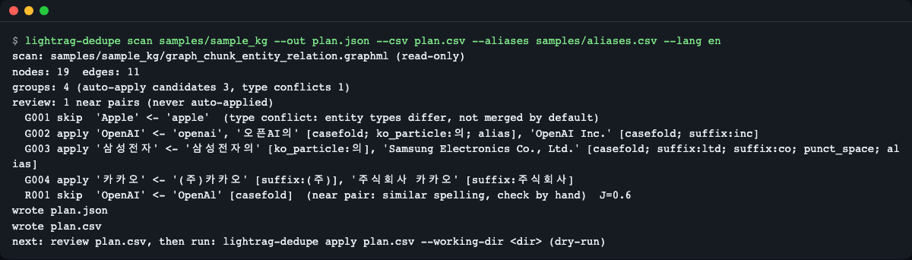
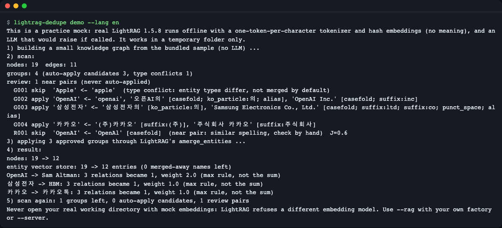
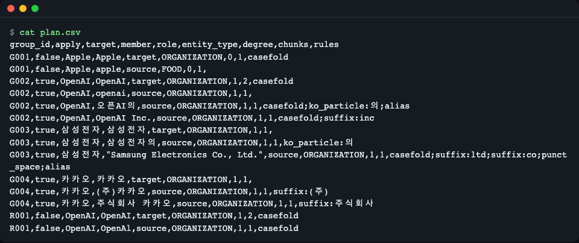
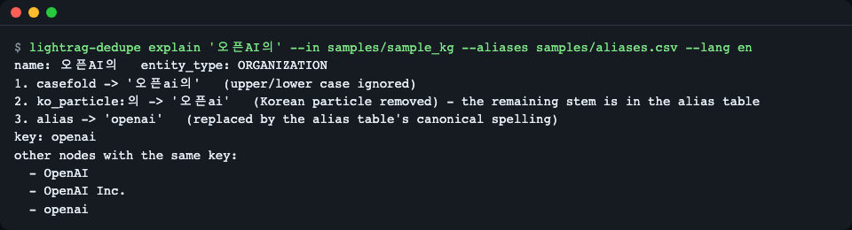
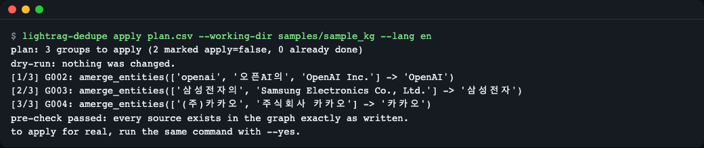
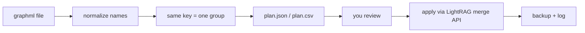

# lightrag-dedupe

**English** | [한국어](README.ko.md)

Find the same entity written in different ways in a LightRAG knowledge graph (`OpenAI`, `openai`, `OpenAI Inc.`, `오픈AI의`), get a merge plan you can review, and apply only the groups you approve through LightRAG's own merge API. No LLM calls, no network, no API key: the same graph always gives the same plan. This is an unofficial tool, not part of LightRAG.


*`scan` reads a LightRAG working folder and lists groups of nodes that are probably one entity, each with the rules that matched.*

## Who it is for

- You indexed hundreds of documents with LightRAG and the graph viewer shows one company as five nodes.
- Your documents mix Korean and English, so names carry particles (`삼성전자의`), company markers (`(주)카카오`, `Co., Ltd.`) or two scripts (`오픈AI`).
- You want a cleanup step you can re-run in a script and review in a spreadsheet before anything changes.

## Install

Requires Python 3.11+. [uv](https://docs.astral.sh/uv/) is the easiest way to run it (`curl -LsSf https://astral.sh/uv/install.sh | sh`).

```bash
uv tool install git+https://github.com/LeeGyeongPil/lightrag-dedupe
```

`scan`, `explain`, `restore` and `apply --server` use only the Python standard library. `apply --rag` and `demo` need LightRAG itself (`lightrag-hku`, version 1.5.x), which you already have if you run LightRAG from Python.

To try it from a clone (this also installs LightRAG for the demo):

```bash
git clone https://github.com/LeeGyeongPil/lightrag-dedupe
cd lightrag-dedupe
uv sync
```

On a minimal Linux image you need `git` and `curl` before the commands above.

## Quick start (30 seconds, practice mock)

```bash
uv run lightrag-dedupe demo --lang en
```

```text
This is a practice mock: real LightRAG 1.5.8 runs offline with a one-token-per-character tokenizer and hash embeddings (no meaning), and an LLM that would raise if called. It works in a temporary folder only.
1) building a small knowledge graph from the bundled sample (no LLM) ...
2) scan:
nodes: 19  edges: 11
groups: 4 (auto-apply candidates 3, type conflicts 1)
review: 1 near pairs (never auto-applied)
  G001 skip  'Apple' <- 'apple'  (type conflict: entity types differ, not merged by default)
  G002 apply 'OpenAI' <- 'openai', '오픈AI의' [casefold; ko_particle:의; alias], 'OpenAI Inc.' [casefold; suffix:inc]
  G003 apply '삼성전자' <- '삼성전자의' [ko_particle:의], 'Samsung Electronics Co., Ltd.' [casefold; suffix:ltd; suffix:co; punct_space; alias]
  G004 apply '카카오' <- '(주)카카오' [suffix:(주)], '주식회사 카카오' [suffix:주식회사]
  R001 skip  'OpenAI' <- 'OpenAl' [casefold]  (near pair: similar spelling, check by hand)  J=0.6
3) applying 3 approved groups through LightRAG's amerge_entities ...
4) result:
nodes: 19 -> 12
entity vector store: 19 -> 12 entries (0 merged-away names left)
OpenAI -> Sam Altman: 3 relations became 1, weight 2.0 (max rule, not the sum)
삼성전자 -> HBM: 3 relations became 1, weight 1.0 (max rule, not the sum)
카카오 -> 카카오톡: 3 relations became 1, weight 1.0 (max rule, not the sum)
5) scan again: 1 groups left, 0 auto-apply candidates, 1 review pairs
Never open your real working directory with mock embeddings: LightRAG refuses a different embedding model. Use --rag with your own factory or --server.
```


*The whole flow on a bundled sample graph: scan, merge through LightRAG, check the result, scan again.*

This is a **practice mock** (it is labeled as one in the output): it builds a small graph in a temporary folder with fake hash embeddings and an LLM that is never called. The merge itself is real LightRAG 1.5.8 code. Use it only to see the flow; never open your own working folder with mock embeddings (LightRAG refuses a different embedding model).

## Usage

The normal flow is `scan`, review `plan.csv`, `apply` (preview), `apply --yes`.

| Command | What it does |
|---|---|
| `scan PATH [--out plan.json] [--csv plan.csv] [--aliases aliases.csv] [--near 0.6]` | Reads the graph file in a working folder (read-only) and writes the plan. |
| `explain NAME --in PATH [--aliases aliases.csv]` | Shows the rule chain that gave one node its key, and the other nodes with the same key. |
| `apply PLAN [--working-dir DIR] [--rag FILE.py:FUNC \| --server URL] [--yes]` | Applies groups marked `apply=true`. Without `--yes` it only prints the calls it would make. |
| `restore BACKUP --working-dir DIR [--yes]` | Puts back a backup that `apply` made. |
| `demo` | The practice mock above. |
| `--lang en\|ko` | Screen language (see Settings). |

Exit codes: `0` success, `2` input or usage error, `3` the plan no longer matches the graph, `4` a merge failed.

### 1. Scan

```bash
uv run lightrag-dedupe scan samples/sample_kg --out plan.json --csv plan.csv --aliases samples/aliases.csv --lang en
```

```text
scan: samples/sample_kg/graph_chunk_entity_relation.graphml (read-only)
nodes: 19  edges: 11
groups: 4 (auto-apply candidates 3, type conflicts 1)
review: 1 near pairs (never auto-applied)
  G001 skip  'Apple' <- 'apple'  (type conflict: entity types differ, not merged by default)
  G002 apply 'OpenAI' <- 'openai', '오픈AI의' [casefold; ko_particle:의; alias], 'OpenAI Inc.' [casefold; suffix:inc]
  G003 apply '삼성전자' <- '삼성전자의' [ko_particle:의], 'Samsung Electronics Co., Ltd.' [casefold; suffix:ltd; suffix:co; punct_space; alias]
  G004 apply '카카오' <- '(주)카카오' [suffix:(주)], '주식회사 카카오' [suffix:주식회사]
  R001 skip  'OpenAI' <- 'OpenAl' [casefold]  (near pair: similar spelling, check by hand)  J=0.6
wrote plan.json
wrote plan.csv
next: review plan.csv, then run: lightrag-dedupe apply plan.csv --working-dir <dir> (dry-run)
```

How to read it: `G…` lines are groups of nodes that normalize to the same key. `'OpenAI' <- 'openai', …` means "merge the sources into the target". The part in `[...]` is the evidence: the rules that changed that name. `skip` groups are not applied by default (`apply=false` in the plan). The `R001` line is a *near pair* (`OpenAI` vs `OpenAl` with a lowercase L). It is only listed for you to check by hand; the tool never merges near pairs on its own.

For your own data, point `scan` at the LightRAG working folder (the one that contains `graph_chunk_entity_relation.graphml`).

### 2. Review the plan

```bash
cat plan.csv
```

```text
group_id,apply,target,member,role,entity_type,degree,chunks,rules
G001,false,Apple,Apple,target,ORGANIZATION,0,1,casefold
G001,false,Apple,apple,source,FOOD,0,1,
G002,true,OpenAI,OpenAI,target,ORGANIZATION,1,2,casefold
G002,true,OpenAI,openai,source,ORGANIZATION,1,1,
G002,true,OpenAI,오픈AI의,source,ORGANIZATION,1,1,casefold;ko_particle:의;alias
G002,true,OpenAI,OpenAI Inc.,source,ORGANIZATION,1,1,casefold;suffix:inc
G003,true,삼성전자,삼성전자,target,ORGANIZATION,1,1,
G003,true,삼성전자,삼성전자의,source,ORGANIZATION,1,1,ko_particle:의
G003,true,삼성전자,"Samsung Electronics Co., Ltd.",source,ORGANIZATION,1,1,casefold;suffix:ltd;suffix:co;punct_space;alias
G004,true,카카오,카카오,target,ORGANIZATION,1,1,
G004,true,카카오,(주)카카오,source,ORGANIZATION,1,1,suffix:(주)
G004,true,카카오,주식회사 카카오,source,ORGANIZATION,1,1,suffix:주식회사
R001,false,OpenAI,OpenAI,target,ORGANIZATION,1,2,casefold
R001,false,OpenAI,OpenAl,source,ORGANIZATION,1,1,casefold
```


*One row per node. Open it in a spreadsheet and change `apply` to `true` or `false`, or edit `target`, before you apply. CSV column names are always English.*

Rows with the same `group_id` form one merge. Edit the CSV (or `plan.json`) freely; `apply` checks the result again and rejects empty sources, a target that is also a source, and overlapping groups (exit code 2).

### 3. Explain one name

```bash
uv run lightrag-dedupe explain "오픈AI의" --in samples/sample_kg --aliases samples/aliases.csv --lang en
```

```text
name: 오픈AI의   entity_type: ORGANIZATION
1. casefold -> '오픈ai의'   (upper/lower case ignored)
2. ko_particle:의 -> '오픈ai'   (Korean particle removed) - the remaining stem is in the alias table
3. alias -> 'openai'   (replaced by the alias table's canonical spelling)
key: openai
other nodes with the same key:
  - OpenAI
  - OpenAI Inc.
  - openai
```


*Each numbered line is one rule and the name it produced. Nodes that end with the same `key` are one group.*

### 4. Preview the apply

```bash
uv run lightrag-dedupe apply plan.csv --working-dir samples/sample_kg --lang en
```

```text
plan: 3 groups to apply (2 marked apply=false, 0 already done)
dry-run: nothing was changed.
[1/3] G002: amerge_entities(['openai', '오픈AI의', 'OpenAI Inc.'] -> 'OpenAI')
[2/3] G003: amerge_entities(['삼성전자의', 'Samsung Electronics Co., Ltd.'] -> '삼성전자')
[3/3] G004: amerge_entities(['(주)카카오', '주식회사 카카오'] -> '카카오')
pre-check passed: every source exists in the graph exactly as written.
to apply for real, run the same command with --yes.
```


*Nothing changed. The pre-check confirms every source name still exists in the graph exactly as written; if not, nothing is touched and the exit code is 3.*

### 5. Apply for real, and undo

The Python path needs a small factory function that builds your LightRAG instance (not yet initialized) exactly as in your indexing script, with **your** embedding function. `samples/demo_factory.py` is a template. To try it safely, first create a throwaway LightRAG working folder from the bundled sample (offline, from a clone):

```bash
uv run python -c "from lightrag_dedupe.demo import create_sample_working_dir; create_sample_working_dir('rag_storage')" 2>/dev/null
```

Then apply with the bundled mock factory:

```bash
RAG_WORKING_DIR=rag_storage uv run lightrag-dedupe apply plan.csv --rag samples/demo_factory.py:build_rag --yes --lang en
```

```text
plan: 3 groups to apply (2 marked apply=false, 0 already done)
backup: /…/rag_storage.lightrag-dedupe-backups/20261127T005706Z
[1/3] G002: merging 3 nodes into 'OpenAI'
[2/3] G003: merging 2 nodes into '삼성전자'
[3/3] G004: merging 2 nodes into '카카오'
done: 3 groups merged.
```

LightRAG prints many INFO log lines to stderr while merging; add `2>/dev/null` to hide them.

Before merging, the whole working folder is copied to `<working-dir>.lightrag-dedupe-backups/<timestamp>` with a sha256 manifest. To undo (stop any LightRAG process using that folder first):

```bash
uv run lightrag-dedupe restore rag_storage.lightrag-dedupe-backups/20261127T005706Z --working-dir rag_storage --yes --lang en
```

```text
restored 12 files into /…/rag_storage.
```

The timestamp folder name is the one printed on the `backup:` line of your own `apply` run (use that, not the one shown here). Without `--yes`, `restore` only verifies the backup and says how many files would be restored. Running `apply` again is safe: groups already done are skipped (recorded in `apply-log.jsonl`), and when you pass `--working-dir`, groups whose sources reappear (for example after a restore) are applied again.

For a running LightRAG server use `--server http://localhost:9621` (calls `POST /graph/entities/merge`). Pass `--working-dir` for the pre-check and backup, or `--no-backup` to say you accept no backup. If the server has an API key, set `LIGHTRAG_API_KEY`.

### Use your own LightRAG

Run the tool from the same Python environment as your LightRAG app, because your factory imports your own embedding and LLM packages (`openai`, `ollama`, ...). Install it into that environment instead of an isolated tool environment:

```bash
uv pip install "lightrag-dedupe @ git+https://github.com/LeeGyeongPil/lightrag-dedupe"
```

Then write a factory like your indexing script, and point `--rag` at it (`my_factory.py`):

```python
from lightrag import LightRAG

def build_rag():
    # same working_dir, embedding_func and llm_model_func as when you indexed
    return LightRAG(working_dir="./rag_storage", embedding_func=my_embedding, llm_model_func=my_llm)
```

```bash
lightrag-dedupe apply plan.csv --rag my_factory.py:build_rag --working-dir ./rag_storage
```

Gotchas:

- Stop any LightRAG server or process that uses the working folder before `apply --rag`; its in-memory state could overwrite the merge. (With `--server` the server stays up.)
- Do not apply while documents are being indexed; LightRAG answers with a conflict (409) and the group fails. Wait for indexing to finish and run `apply` again.
- LightRAG downloads the tiktoken encoding file when it is created. Offline, prepare it first (`lightrag-download-cache`) and set `TIKTOKEN_CACHE_DIR`, or pass your own tokenizer in the factory.
- Names in the plan must be written exactly as stored (case, spaces, punctuation); the pre-check rejects anything else.

## Settings

| Setting | Meaning |
|---|---|
| `--lang en\|ko` | Screen language. Order: `--lang`, then `LIGHTRAG_DEDUPE_LANG`, then `LC_ALL` / `LC_MESSAGES` / `LANG`; anything not starting with `ko` gives English. Rule codes, JSON keys and CSV columns are never translated. |
| `LIGHTRAG_API_KEY` | Sent as `X-API-Key` for `apply --server`, only if your server has a key. See `.env.example`. The tool does not load `.env` itself. |
| `--aliases FILE` | CSV with columns `variant,canonical` for spellings no rule can derive (`오픈AI` → `OpenAI`). See `samples/aliases.csv`. |
| `--near 0.6` | Trigram similarity needed to list a near pair for review (0 to 1). |
| `--workspace NAME` | LightRAG workspace sub-folder inside the working folder. |

`scan` supports the default NetworkX storage (a `.graphml` file). Neo4j or PostgreSQL graphs are not scanned yet, though `apply --server` works with any storage the server uses.

## Language

Screens are in English or Korean. Pick one with `--lang en|ko`, or set `LIGHTRAG_DEDUPE_LANG=ko`; without either, `LC_ALL` / `LC_MESSAGES` / `LANG` decide (anything not starting with `ko` gives English). Rule codes, JSON keys and CSV columns stay in English. Save `plan.csv` as "CSV UTF-8" if you edit it in a spreadsheet; the tool writes it with a BOM so Excel shows Korean names correctly.

## How it decides



- **normalize names**: each name goes through fixed rules in order: Unicode NFKC, case folding, repeated company markers (`Inc.`, `Co., Ltd.`, `주식회사`, `(주)`, `㈜`), a Korean particle (`의`, ...), spaces and punctuation, then your alias table. Every rule that changed the name is recorded as evidence.
- **Korean particles are careful**: `삼성전자의` loses `의` only if `삼성전자` exists as another node or alias. `마이크로` is left alone because there is no `마이크` node (so `로` is not mistaken for a particle).
- **same key = one group**: no chains, so one wrong link cannot pull unrelated names together. Nodes with different entity types (`Apple` the company and `apple` the food) are marked `type_conflict` and skipped by default.
- **the target name** is chosen without any model: the alias canonical name, then a name with no surface rules applied, then the most source chunks, then the highest degree, then the shorter name.
- **near pairs** (similar but different keys) are listed for you only; the tool never merges them.
- **apply goes through LightRAG**: the graph file is never edited directly, because the vector store and chunk tracking would then disagree with it. LightRAG merges relations by keeping the maximum weight, not the sum.

## When to use it

- A good fit: you already have a LightRAG graph with spelling variants, and you want a repeatable, explainable, offline cleanup with a file to review.
- Not covered: a name written in another script (`오픈AI` vs `OpenAI`) is not guessed; put it in the alias CSV. Deciding that two *different-looking* names are the same thing by meaning needs an LLM or a human.
- Other ways to merge in LightRAG itself: its WebUI graph editor and `merge_entities` / `POST /graph/entities/merge` ([LightRAG](https://github.com/HKUDS/LightRAG)). They merge what you name; they do not look for candidates. This tool finds candidates and then calls that same API.

## Compared with

Checked 2026-11-27; see each project for its current features.

- **LightRAG's own merge** (WebUI editor, `merge_entities`, `POST /graph/entities/merge`): merges the names you give it. This tool produces the candidates and calls it. [LightRAG](https://github.com/HKUDS/LightRAG)
- **nodecanon** ([PyPI](https://pypi.org/project/nodecanon/), 0.1.1 when checked): another way to find duplicate nodes in a graph file. Read its README for how it scores, what it downloads and how it writes results back.
- **lightragmcp** ([GitHub](https://github.com/lalitsuryan/lightragmcp)): an MCP server around the LightRAG REST API that exposes a merge tool, so an agent decides what to merge.

## Limits & roadmap

- `scan` reads the default NetworkX `.graphml` storage only. Neo4j and PostgreSQL graphs are not scanned yet (`apply --server` works with them).
- Spellings in another script are not guessed; add them to the alias CSV.
- Near pairs are listed, never merged.
- Planned: scan through a running server (non-NetworkX storages), and a switch to turn rules on and off. After that: ranking of review pairs with your own embeddings (never auto-merged) and `scan --diff` to show only duplicates that appeared after new documents. Plans can change.

## Troubleshooting

| Symptom | Cause | Fix |
|---|---|---|
| Exit code 3, "nothing was changed" | The graph changed after `scan`, so a source name is missing or different. | Run `scan` again and re-apply your edits. |
| Exit code 4 while applying | LightRAG or the server refused a merge (for example a 409). | Fix the cause, run the same `apply` again; finished groups are skipped. |
| `demo` or `apply --rag` asks for LightRAG | `lightrag-hku` is not installed in this environment. | Install the extra: `uv tool install "lightrag-dedupe[lightrag] @ git+https://github.com/LeeGyeongPil/lightrag-dedupe"`, or use `uv sync` in a clone. |
| LightRAG refuses to open the folder | Your factory uses a different embedding model than the one that built the data. | Build LightRAG in the factory exactly like your indexing script. |
| `apply --server` refuses `--yes` | No backup path given. | Add `--working-dir DIR`, or `--no-backup`. |
| `plan.csv` is rejected as not UTF-8 (exit 2) | A spreadsheet saved it as CP949 or another encoding. | Save as "CSV UTF-8" and run again. |
| `graph file not found: rag_storage/...` | The working folder does not exist yet. | Create the sample folder first (step 5) or point to your own LightRAG folder. |
| A group you expected is missing | The names differ by more than the rules cover. | Add an alias row, check `R…` review lines, or lower `--near`. |

## Development

```bash
uv sync
uv run pytest -q
```

Tests run offline and merge with real `lightrag-hku` 1.5.8. Bugs and suggestions are welcome as issues. Changes are listed in [CHANGELOG.md](CHANGELOG.md).

## License

MIT. The bundled sample graph is synthetic.
